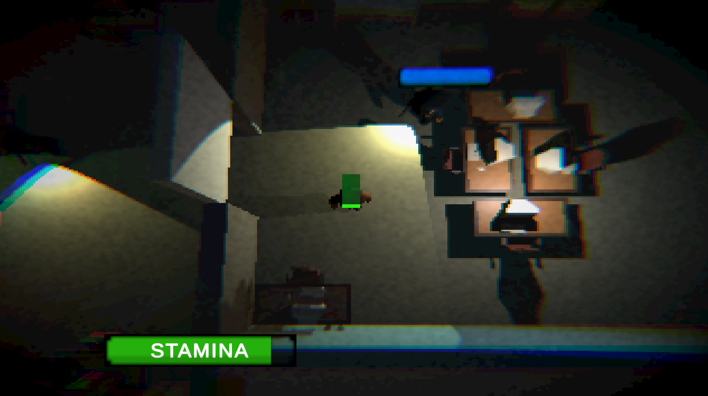
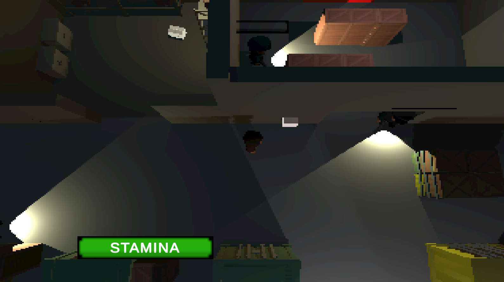
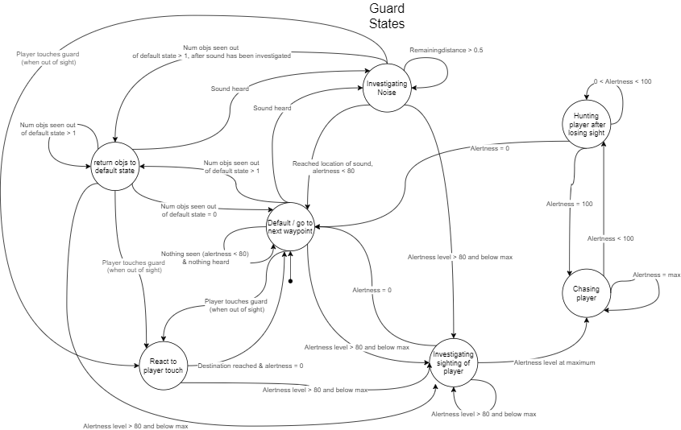
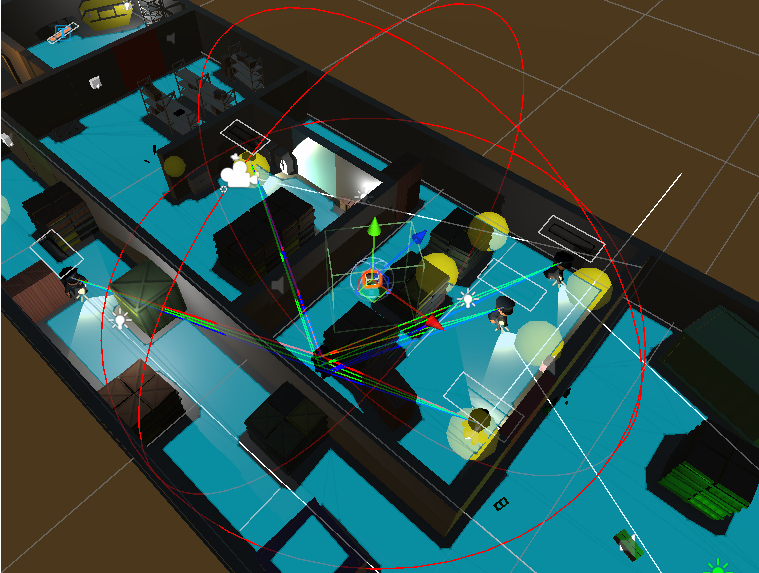
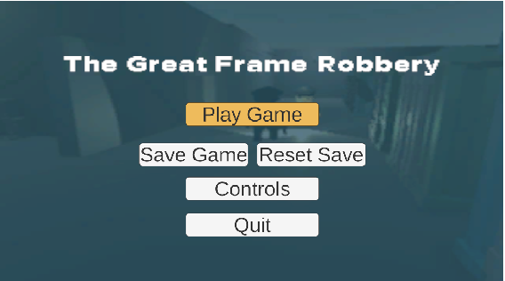
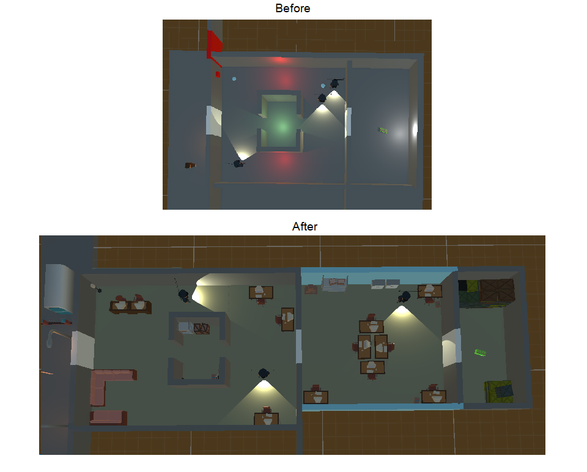

# The Great Frame Robbery

A top-down stealth and heist game made in Unity by Will Bosley and me for the Games Development
module (CMP-7042B) at the University of East Anglia in 2023.

You play a gamer whose PC is grinding to a halt. Graphics cards are only available on resale for a
lot of money, so they start doing heists to pay for one. There's no combat. Each level has one item
to steal, and you get it by sneaking past guards, luring them away with noise, and using the level
to your advantage.



## Playing it

The game is in the `Build` folder and runs on Windows.

1. Download the project as a zip (the green "Code" button) and unzip it.
2. Open the `Build` folder and run `gamedev.exe`.
3. Windows may warn you that the file is unrecognised. Click "More info" and then "Run anyway".

The Unity project itself is in the `gamedev` folder.

### Controls

| Action | Keyboard | Controller |
| --- | --- | --- |
| Move | WASD or arrow keys | Left stick |
| Interact / pick up / drop | F | A |
| Sprint (hold) | Shift | B |
| Leave the level | Esc | Start |

## How it plays

There are five levels, each designed by hand, and every level adds something new:

1. Guards patrolling routes and automatic doors.
2. Using noise. Dropping a box makes a sound that guards will come and investigate.
3. Button doors, and guards who notice when something has changed. If they see a door open that
   should be closed, they walk over and press the button to close it again.
4. and 5. Coloured key cards that open locked doors of the same colour.

You can only hold one item at a time, and it sits on your head so it's always clear what you're
carrying. You can sprint, but stamina is limited, so it's better to stay out of sight. If a guard
catches you the level restarts.



The look is based on PlayStation 1 games like Metal Gear Solid, with low poly cartoon models but
modern dynamic lighting. The camera is tilted slightly rather than straight down, and it only ever
moves and never rotates, so you always know which way is up.

## How the guards work

The guards are a state machine on top of Unity's nav-mesh agents. It looks complicated because
there are seven states, but most of it comes down to a few numbers each guard keeps track of:

- **Alertness**, from 0 to 100. It rises while they can see you and falls when they can't.
- Whether they've seen an object that isn't in its normal state, like an open door.
- Whether they've heard a noise.
- Whether they've felt you brush past behind them.



The diagram splits into two halves. If alertness goes above 80, the guard moves into the "seeing
the player" half: investigating, chasing, and hunting you after losing sight. They don't go back
until alertness drops to zero. In the other half, reacting to being touched has top priority, then
investigating a noise, then putting the level back to normal. Each guard remembers what it was
doing, so if you distract one on its way to close a door, it goes back to the door afterwards.

Each guard has a `GuardStateManager`, and every state is a subclass of the abstract
`GuardBaseState` with its own `updateState`, which runs every frame and decides whether to switch.

**Sight.** A guard can only see you inside its vision range and field of view, which is what its
torch beam shows. Like in Splinter Cell: Blacklist, the guard casts six rays from its head to your
limbs. The more limbs it can see, and the closer you are, the faster alertness rises. The rate is
worked out every frame, but alertness itself is updated on a fixed timestep so your frame rate
doesn't change how quickly you're spotted.

**Hearing.** A sound is just a position and a range. When a box hits the floor, a
`Physics.OverlapSphere` the size of the sound's range finds every guard inside it, and they each
store where the sound came from to investigate.



**Fixing the level.** Doors implement a `HasDefault` interface that says whether they're in their
normal state and which buttons can change them. When a guard spots a door in the wrong state, it
works out the path to each of those buttons, ignores any it can't reach (for example behind a
locked door), and walks to the closest.

**Patrols.** Guards follow waypoints in a loop, or stand still if they only have one. After a chase,
the closest guard to a waypoint moves fastest and the others slow down, so they don't all bunch up
on the same route. Each guard's nav-mesh agent has a different priority, so in tight spaces one
always pushes past the other instead of them getting stuck.

## Other bits

- **The pixelated look.** The camera renders to a 320x240 render texture, which is drawn to the
  screen through a UI raw image. We first tried a PS1 shader from the Asset Store, but it only
  worked with the built-in render pipeline and we were using URP.
- **Being chased.** The `GameManager` finds the highest alertness of all the guards each frame and
  uses it to drive film grain, chromatic aberration, vignette and suspense music. Stinger sounds
  play when you're first noticed and when a chase starts, and only once each until you've fully
  hidden again.
- **Lighting.** URP lets each object be lit by up to 8 lights, so floors are split into one object
  per room, and walls stop light spilling between rooms.
- **Doors.** Doors subscribe to events in `GameEvents` with an ID, so trigger areas, buttons and
  key card readers can open, close or toggle any door with a matching ID.
- **Menus.** The menu works with mouse, keyboard or controller, saves your progress, and auto-saves
  when you finish a level.



## Play testing

Will and I played each other's levels throughout development, and we got friends and family to try
it too. A lot changed because of it. For example, the guards in level 1 were originally stationary,
which was too easy and boring, so they patrol now. We also cut extra joke items, like putting a
saucepan on your head, because having things to pick up that didn't matter made it confusing to
know what you were meant to steal.



## Code layout

```
gamedev/Assets
├── Guard                 the state machine, each state, senses, alertness bar, waypoints
│   └── Guard Hearing     Sound, Sounds and the SoundHearer interface
├── Interactive           IInteractable, HasDefault, GameEvents, picking up and dropping items
│   └── Door              door controller, buttons, trigger areas and key card readers
├── Player                movement, sprint and stamina, input, animation
├── HUD + Display         menus, stamina bar, keeping the menu across scenes
├── Level Parts           level pieces and the end of level trigger
├── GameManager.cs        loading and saving levels, chase effects
├── Scenes
└── Old and Testing       early prototypes
```

## What we'd add next

The game is short, but we got the base of it polished, with the AI, levels and art working well
together. Next would be more content and mechanics, like an alarm that sends every guard looking
for you, or a wet floor sign you can carry that guards won't walk past.

## Credits

The models, sounds and music are free assets made by other people, and everyone is credited on
the credits screen at the end of the game. The player and guard models are from Toony Tiny People
by Polygon Blacksmith.
